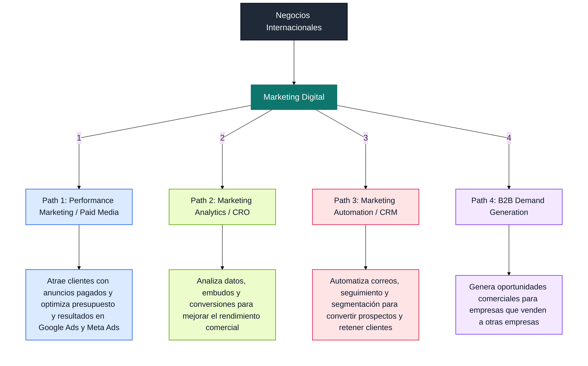

# Mapa de Rutas Profesionales en Marketing

---

<h2 style="display:inline-block;margin:18px 0 10px 0;padding:8px 14px;border:2px solid #2563eb;border-radius:0;color:#2563eb;background:#dbeafe;">Path 1: Performance Marketing / Paid Media</h2>

<strong>Descripción general</strong> 
Esta ruta se centra en crear, lanzar y optimizar campañas pagadas para atraer clientes, generar leads y medir resultados con precisión. Es una rama muy estratégica del marketing, porque convierte presupuesto en tráfico, clics y ventas; en otras palabras, funciona como un laboratorio con dinero real donde se prueban anuncios, se comparan resultados y se ajusta todo hasta que solo quede lo que realmente funciona.

<strong>Así se entiende mejor</strong>

- <strong>Vendedor digital:</strong> trabaja todo el tiempo buscando clientes.
- <strong>Laboratorio:</strong> prueba audiencias, anuncios y mensajes.
- <strong>Tablero de control:</strong> cada decisión se toma con datos.

<strong>Escenario del día a día</strong>

- Revisa qué campañas están activas y cuáles están gastando más presupuesto.
- Analiza clics, conversiones, costo por lead y retorno para entender el rendimiento.
- Pausa anuncios que no están funcionando y refuerza los que sí están dando resultados.
- Ajusta textos, imágenes o videos para elevar el desempeño.
- Detecta qué audiencia responde mejor y en qué segmento conviene invertir.
- Presenta resultados al equipo o al cliente y explica qué se debe hacer después.
- Prueba nuevas ideas para bajar costos y subir conversiones de forma constante.

<strong>Qué se aprende y se hace</strong>

- <strong>Google Ads:</strong> plataforma para crear anuncios en las búsquedas de Google y en su red de sitios asociados.
- <strong>Meta Ads:</strong> sistema de anuncios para Facebook e Instagram que permite llegar a audiencias específicas.
- <strong>GA4:</strong> herramienta de analitica para medir tráfico, conversiones y comportamiento de usuarios en un sitio.
- <strong>Copywriting:</strong> escritura de textos persuasivos para anuncios, titulares y llamadas a la accion.
- <strong>Segmentacion:</strong> proceso de elegir a que tipo de personas se les mostrara un anuncio.
- <strong>Landing pages:</strong> paginas disenadas para convertir visitas en leads o ventas.
- <strong>Metricas:</strong> numeros que muestran si una campana esta funcionando o no.

<strong>Certificaciones</strong>

- <strong>Google Ads Search:</strong> para crear campañas de busqueda, elegir palabras clave, ajustar pujas y aparecer justo cuando alguien ya esta buscando ese producto o servicio.
- <strong>Google Ads Display:</strong> para mostrar anuncios visuales en sitios web y apps, trabajar segmentacion y hacer remarketing.
- <strong>Meta Blueprint:</strong> para crear campañas en Facebook e Instagram, segmentar audiencias y probar creativos.
- <strong>GA4:</strong> para medir trafico, conversiones y comportamiento de usuarios dentro de un sitio o ecommerce.
- <strong>HubSpot Digital Marketing:</strong> para entender fundamentos de marketing digital, embudos, contenido y medicion.
- <strong>Google Tag Manager:</strong> para instalar y administrar etiquetas de seguimiento sin depender tanto del codigo.
- <strong>Google Ads Video:</strong> para crear campañas en YouTube, usar formatos de video y trabajar estrategias de alcance.

<strong>Cursos recomendados</strong>

- <strong>Google Skillshop:</strong> formacion practica para aprender Google Ads y certificarte con ejercicios reales.
- <strong>Meta Blueprint:</strong> cursos para dominar campañas en Facebook e Instagram y optimizar anuncios.
- <strong>HubSpot Academy:</strong> para aprender embudos, inbound marketing, contenido y automatizacion basica.
- <strong>Excel / Google Sheets:</strong> para analizar resultados, organizar datos de campañas y preparar reportes.
- <strong>Copywriting:</strong> para escribir anuncios, titulos y llamadas a la accion que generen clics.
- <strong>Google Tag Manager Course:</strong> para configurar eventos, conversiones y etiquetas de seguimiento.
- <strong>Landing Page Optimization:</strong> para mejorar paginas de aterrizaje y convertir mas visitas en leads.

<strong>Tiempo estimado del path</strong> 
4 a 6 meses

<strong>Principales enfoques</strong>

- Publicidad de pago
- Optimización de presupuesto
- Generación de leads
- Medición de resultados
- A/B testing

<strong>Salario</strong>

- <strong>A corto plazo:</strong> 15,000 a 25,000 MXN mensuales
- <strong>A largo plazo:</strong> 35,000 a 65,000+ MXN mensuales

<strong>Dificultad</strong> 
Media

<strong>Horas de estudio</strong> 
2 a 3 horas al día

<strong>Porcentaje de encaje con su carrera</strong> 
<strong>70%</strong> de encaje con <strong>Negocios Internacionales</strong>. Encaja bien porque aprovecha visión comercial, análisis de mercados y manejo de públicos; no es una continuidad directa de la carrera, pero sí una transición muy natural hacia un rol más digital y medible.

---

<h2 style="display:inline-block;margin:18px 0 10px 0;padding:8px 14px;border:2px solid #65a30d;border-radius:0;color:#65a30d;background:#ecfccb;">Path 2: Marketing Analytics / CRO</h2>

<strong>Descripción general</strong> 
Esta ruta se enfoca en leer datos, entender patrones y traducir números en decisiones. Es como ser una detective del marketing: no solo mira qué pasó, sino por qué pasó, dónde se pierde la gente y qué cambio puede mejorar el resultado.

<strong>Así se entiende mejor</strong>

- <strong>Detective de datos:</strong> busca pistas en campañas, páginas y embudos.
- <strong>Arquitecta de dashboards:</strong> organiza la información para que el equipo entienda todo rápido.
- <strong>Traductora de números:</strong> convierte métricas en acciones concretas.

<strong>Escenario del día a día</strong>

- Revisa dashboards para ver qué canal está trayendo más tráfico o ventas.
- Detecta en qué parte del embudo se están perdiendo usuarios.
- Analiza campañas para saber cuál está dando mejor retorno.
- Prepara reportes claros para que el equipo o cliente entienda los datos.
- Propone pruebas para mejorar conversiones y disminuir fugas.
- Ajusta visualizaciones para que la información sea fácil de leer.

<strong>Qué se aprende y se hace</strong>

- <strong>Google Analytics 4:</strong> para medir tráfico, eventos, conversiones y comportamiento de usuarios.
- <strong>Looker Studio:</strong> para construir dashboards visuales y reportes claros.
- <strong>Excel / Google Sheets avanzado:</strong> para ordenar datos, hacer análisis y detectar tendencias.
- <strong>SQL básico:</strong> para consultar bases de datos y obtener información más precisa.
- <strong>Funnel analysis:</strong> para revisar en qué paso del proceso se pierde la gente.
- <strong>CRO:</strong> para mejorar páginas y procesos que convierten visitas en leads o ventas.
- <strong>A/B testing:</strong> para comparar dos versiones y elegir la que mejor funciona.
- <strong>Visualización de datos:</strong> para presentar números de forma clara y fácil de entender.

<strong>Certificaciones</strong>

- <strong>Google Analytics Certification:</strong> demuestra que sabes medir tráfico, eventos y conversiones.
- <strong>HubSpot Marketing Software:</strong> ayuda a entender automatización, seguimiento y reportes de marketing.
- <strong>Certificado básico de SQL:</strong> útil para consultar datos y sacar reportes más profundos.
- <strong>Excel avanzado:</strong> sirve para análisis, tablas dinámicas y modelos de datos.

<strong>Cursos recomendados</strong>

- <strong>Google Skillshop:</strong> para aprender analítica y herramientas de medición de Google.
- <strong>HubSpot Academy:</strong> para fortalecer fundamentos de marketing y automatización.
- <strong>Curso de SQL:</strong> para aprender a extraer y analizar información de bases de datos.
- <strong>Curso de data visualization:</strong> para crear dashboards más claros y atractivos.
- <strong>Curso de CRO y experimentación:</strong> para mejorar conversiones con pruebas y análisis.

<strong>Tiempo estimado del path</strong> 
6 a 9 meses

<strong>Principales enfoques</strong>

- Análisis de campañas
- Dashboards
- Optimización de conversiones
- Reportes ejecutivos
- Diagnóstico de fugas en embudos

<strong>Salario</strong>

- <strong>A corto plazo:</strong> 18,000 a 30,000 MXN mensuales
- <strong>A largo plazo:</strong> 40,000 a 80,000+ MXN mensuales

<strong>Dificultad</strong> 
Media alta

<strong>Horas de estudio</strong> 
2 a 3 horas al día

<strong>Porcentaje de encaje con su carrera</strong> 
<strong>60%</strong> de encaje con <strong>Negocios Internacionales</strong>. Aprovecha la capacidad de análisis, visión estratégica y lectura de mercados, aunque requiere más trabajo técnico con datos y herramientas.

---

<h2 style="display:inline-block;margin:18px 0 10px 0;padding:8px 14px;border:2px solid #e11d48;border-radius:0;color:#e11d48;background:#ffe4e6;">Path 3: Marketing Automation / CRM</h2>

<strong>Descripción general</strong> 
Esta ruta se dedica a automatizar procesos para que el marketing trabaje de forma más inteligente y no más pesada. Es como tener una asistente digital que da seguimiento a prospectos, envía correos en el momento correcto y ayuda a que nadie se enfríe en el camino.

<strong>Así se entiende mejor</strong>

- <strong>Asistente digital:</strong> da seguimiento sin olvidar a ningún prospecto.
- <strong>Maestra del orden:</strong> organiza correos, contactos y etapas del cliente.
- <strong>Puente entre marketing y ventas:</strong> conecta ambos equipos para que trabajen juntos.

<strong>Escenario del día a día</strong>

- Revisa si los correos automatizados se están enviando bien.
- Segmenta contactos según su nivel de interés o etapa de compra.
- Ajusta flujos para que cada persona reciba el mensaje correcto.
- Da seguimiento a leads para evitar que se pierdan oportunidades.
- Revisa aperturas, clics y conversiones de las campañas de email.
- Coordina con ventas para mejorar la entrega de prospectos.

<strong>Qué se aprende y se hace</strong>

- <strong>HubSpot:</strong> para crear y administrar automatizaciones, correos y CRM.
- <strong>CRM management:</strong> para organizar contactos, clientes y oportunidades.
- <strong>Email marketing:</strong> para diseñar correos que informen, nutran y conviertan.
- <strong>Lead nurturing:</strong> para acompañar prospectos con mensajes según su interés.
- <strong>Segmentación:</strong> para dividir contactos por perfil, comportamiento o etapa.
- <strong>Flujos automatizados:</strong> para crear secuencias que trabajen solas.
- <strong>Integraciones no-code:</strong> para conectar herramientas sin programar.
- <strong>Métricas:</strong> para medir aperturas, clics, conversiones y retención.

<strong>Certificaciones</strong>

- <strong>HubSpot Inbound Marketing:</strong> enseña a atraer y nutrir prospectos con contenido útil.
- <strong>HubSpot Marketing Software:</strong> ayuda a manejar automatización, emails y reportes.
- <strong>HubSpot Sales Software:</strong> sirve para conectar marketing con seguimiento comercial.
- <strong>HubSpot Revenue Operations:</strong> ayuda a alinear marketing, ventas y operación.
- <strong>Klaviyo basics:</strong> útil para automatización en ecommerce y recuperación de ventas.
- <strong>Salesforce basics:</strong> sirve para entender CRM más robustos y entornos corporativos.

<strong>Cursos recomendados</strong>

- <strong>HubSpot Academy:</strong> para aprender automatización, inbound y gestión de CRM.
- <strong>Cursos de email marketing:</strong> para diseñar campañas que conviertan y retengan.
- <strong>Cursos de automatización con Zapier o Make:</strong> para conectar herramientas y automatizar tareas.
- <strong>Cursos de CRM y lifecycle marketing:</strong> para entender el recorrido completo del cliente.

<strong>Tiempo estimado del path</strong> 
5 a 8 meses

<strong>Principales enfoques</strong>

- Automatización
- Seguimiento de leads
- Email marketing
- Retención de clientes
- Relación marketing-ventas

<strong>Salario</strong>

- <strong>A corto plazo:</strong> 18,000 a 30,000 MXN mensuales
- <strong>A largo plazo:</strong> 35,000 a 65,000+ MXN mensuales

<strong>Dificultad</strong> 
Media alta

<strong>Horas de estudio</strong> 
2 horas al día

<strong>Porcentaje de encaje con su carrera</strong> 
<strong>65%</strong> de encaje con <strong>Negocios Internacionales</strong>. Encaja por su lado organizativo, estratégico y comercial, y además conecta bien con procesos, seguimiento y relación con clientes.

---

<h2 style="display:inline-block;margin:18px 0 10px 0;padding:8px 14px;border:2px solid #7c3aed;border-radius:0;color:#7c3aed;background:#f3e8ff;">Path 4: B2B Demand Generation</h2>

<strong>Descripción general</strong> 
Esta ruta se enfoca en generar oportunidades comerciales para empresas que venden a otras empresas. Es una combinación de marketing y ventas, muy parecida a abrir puertas estratégicas: primero identificas a la empresa correcta, luego encuentras a la persona correcta y después le muestras por qué vale la pena conversar.

<strong>Así se entiende mejor</strong>

- <strong>Abrepuertas comercial:</strong> identifica empresas con potencial y crea la oportunidad de contacto.
- <strong>Investigadora de mercado:</strong> busca cuentas, decisores y necesidades reales.
- <strong>Conectora de negocio:</strong> une marketing con ventas para que el proceso cierre mejor.

<strong>Escenario del día a día</strong>

- Investiga empresas que podrían convertirse en clientes.
- Define el perfil ideal de comprador y la industria objetivo.
- Crea campañas en LinkedIn o por email para generar reuniones.
- Da seguimiento a prospectos para moverlos dentro del embudo.
- Ajusta mensajes según el tipo de empresa o decisor.
- Trabaja con ventas para pasar leads más calificados.

<strong>Qué se aprende y se hace</strong>

- <strong>Segmentación B2B:</strong> para elegir empresas, industrias y perfiles de compra adecuados.
- <strong>ICP y buyer persona:</strong> para definir a quién venderle y cómo hablarle.
- <strong>LinkedIn Ads:</strong> para llegar a tomadores de decisión en un entorno profesional.
- <strong>Email outreach:</strong> para contactar prospectos por correo de forma estratégica.
- <strong>Lead generation:</strong> para atraer oportunidades comerciales reales.
- <strong>CRM:</strong> para organizar prospectos y darles seguimiento.
- <strong>Funnel comercial:</strong> para entender cómo avanza un lead hasta convertirse en cliente.
- <strong>Marketing de contenidos orientado a negocio:</strong> para atraer empresas con contenido útil y convincente.

<strong>Certificaciones</strong>

- <strong>HubSpot Inbound Marketing:</strong> enseña a atraer empresas con contenido y estrategia.
- <strong>HubSpot Inbound Sales:</strong> sirve para aprender ventas consultivas y seguimiento más inteligente.
- <strong>LinkedIn Marketing Labs:</strong> ayuda a crear campañas y estrategias dentro de LinkedIn.
- <strong>HubSpot Sales Software:</strong> permite organizar leads, seguimiento y pipeline comercial.

<strong>Cursos recomendados</strong>

- <strong>HubSpot Academy:</strong> para dominar fundamentos de inbound, ventas y automatización.
- <strong>LinkedIn Marketing Labs:</strong> para aprender publicidad y segmentación B2B en LinkedIn.
- <strong>Cursos de ventas consultivas:</strong> para aprender a vender con enfoque estratégico.
- <strong>Cursos de estrategia B2B:</strong> para entender cómo se venden soluciones a empresas.

<strong>Tiempo estimado del path</strong> 
5 a 8 meses

<strong>Principales enfoques</strong>

- Mercado B2B
- Generación de leads
- Relación con ventas
- Estrategia comercial
- Posicionamiento para empresas

<strong>Salario</strong>

- <strong>A corto plazo:</strong> 18,000 a 30,000 MXN mensuales
- <strong>A largo plazo:</strong> 40,000 a 80,000+ MXN mensuales

<strong>Dificultad</strong> 
Media alta

<strong>Horas de estudio</strong> 
2 horas al día

<strong>Porcentaje de encaje con su carrera</strong> 
<strong>75%</strong> de encaje con <strong>Negocios Internacionales</strong>. Es la ruta que más aprovecha su formación previa porque combina mercados, negociación, análisis comercial y visión internacional.

---

## Análisis de mejor path

Si la prioridad es combinar <strong>dinero</strong> y <strong>encaje con Negocios Internacionales</strong>, el orden más inteligente queda así:

### 1. Performance Marketing / Paid Media

<strong>Mejor balance entre dinero rápido y entrada al mercado.</strong> 
Es el path más fuerte para empezar porque tiene más vacantes, resultados más medibles y una curva de aprendizaje que permite mostrar valor relativamente rápido. Encaja bien con Negocios Internacionales porque usa visión comercial, análisis de mercado y toma de decisiones por resultados.

- <strong>Dinero:</strong> muy alto potencial desde temprano.
- <strong>Encaje con la carrera:</strong> alto.
- <strong>Facilidad para entrar:</strong> media.
- <strong>Conclusión:</strong> es la mejor puerta de entrada.

### 2. Marketing Analytics / CRO

<strong>Mejor ruta para subir el valor profesional a mediano plazo.</strong> 
Este path paga bien cuando ya sabes medir, interpretar y optimizar. Encaja con la carrera porque aprovecha análisis, criterio y lectura de negocio, pero pide más dominio técnico.

- <strong>Dinero:</strong> alto.
- <strong>Encaje con la carrera:</strong> medio alto.
- <strong>Facilidad para entrar:</strong> media baja.
- <strong>Conclusión:</strong> muy buena segunda etapa.

### 3. Marketing Automation / CRM

<strong>Ruta sólida para perfiles organizados y orientados a procesos.</strong> 
Tiene buen valor en empresas que quieren escalar seguimiento y retención. Encaja con Negocios Internacionales por el lado operativo y comercial, aunque normalmente se vuelve más fuerte después de conocer bien el funnel y el CRM.

- <strong>Dinero:</strong> medio alto.
- <strong>Encaje con la carrera:</strong> medio alto.
- <strong>Facilidad para entrar:</strong> media.
- <strong>Conclusión:</strong> excelente complemento del perfil.

### 4. B2B Demand Generation

<strong>Ruta más estratégica, pero normalmente más útil cuando ya hay base previa.</strong> 
Tiene buen encaje con Negocios Internacionales porque toca mercados, clientes, decisión comercial y ventas consultivas. Aun así, suele ser más fuerte cuando ya se domina algún otro pilar de marketing.

- <strong>Dinero:</strong> alto, pero más lento al inicio.
- <strong>Encaje con la carrera:</strong> muy alto.
- <strong>Facilidad para entrar:</strong> media baja.
- <strong>Conclusión:</strong> buena meta final, no la primera apuesta.

<strong>Ranking final según la prioridad</strong>

1. <strong>Performance Marketing / Paid Media</strong> - mejor equilibrio entre dinero, vacantes y entrada rápida.
2. <strong>Marketing Analytics / CRO</strong> - mejor salto de valor a mediano plazo.
3. <strong>Marketing Automation / CRM</strong> - muy útil para consolidar el perfil.
4. <strong>B2B Demand Generation</strong> - más estratégico, pero conviene después.

<strong>Recomendación final</strong> 
Si quiere maximizar ingresos sin alejarse demasiado de su carrera original, la mejor ruta es empezar por <strong>Performance Marketing</strong>, luego sumar <strong>Analytics</strong> y después fortalecer <strong>CRM / Automation</strong>. Con esa combinación obtiene la mejor mezcla de vacantes, aprendizaje práctico y encaje con Negocios Internacionales.

---

## Prioridad de aprendizaje basada en demanda del mercado

Si el objetivo no es aplicar a vacantes ahora, sino decidir qué aprender primero, el orden más útil es este:

### 1. Performance Marketing / Paid Media

Esta debe ser la primera prioridad. Es la ruta con más señal de mercado, mejor relación entre velocidad de aprendizaje y valor salarial, y la que mejor abre puertas para otros caminos.

<strong>Por qué va primero:</strong>

- Es la habilidad más repetida en el archivo de vacantes.
- Conecta directo con resultados medibles: leads, ventas, CAC, ROAS y conversiones.
- Tiene el mejor equilibrio entre entrada relativamente rápida y sueldos más altos.
- Te obliga a entender negocio, audiencias, presupuesto y métricas al mismo tiempo.

<strong>Qué aprender primero dentro de esta ruta:</strong>

- Meta Ads.
- Google Ads.
- TikTok Ads.
- Copywriting para anuncios.
- GA4 y Google Tag Manager.
- Landing pages y conversion rate basics.

### 2. Marketing Analytics / CRO

Debe ser la segunda prioridad porque te da criterio para interpretar el impacto real de lo que haces en performance.

<strong>Por qué va después:</strong>

- No siempre es la puerta de entrada más fácil, pero sí eleva mucho tu valor.
- Te vuelve mejor en reporting, optimización y toma de decisiones.
- Te ayuda a detectar fugas en embudos y a justificar presupuesto con datos.

<strong>Qué aprender después de performance:</strong>

- GA4 avanzado.
- Looker Studio.
- Excel o Google Sheets avanzado.
- Funnel analysis.
- CRO y A/B testing.
- SQL básico como plus.

### 3. Marketing Automation / CRM

Esta es la tercera prioridad. Es clave para volver más eficiente la generación y gestión de demanda, pero rinde más cuando ya entiendes el flujo de leads y conversiones.

<strong>Por qué va tercero:</strong>

- Convierte interés en seguimiento y seguimiento en oportunidad.
- Te ayuda a trabajar con marketing y ventas al mismo tiempo.
- Sube mucho tu valor en empresas que operan con pipeline, lead scoring y nurturing.

<strong>Qué aprender en esta etapa:</strong>

- HubSpot.
- CRM management.
- Email marketing.
- Lead nurturing.
- Segmentación.
- Automatizaciones con herramientas no-code.

### 4. B2B Demand Generation

Esta es la cuarta prioridad. Tiene alto valor, pero conviene después de dominar al menos una base fuerte en performance, analytics o CRM.

<strong>Por qué va al final:</strong>

- Exige entender bien el mercado, la venta consultiva y la relación marketing-ventas.
- Suele pedir más contexto comercial y menos ejecución táctica aislada.
- Es más potente cuando ya sabes generar leads y medir calidad.

<strong>Qué aprender cuando llegues aquí:</strong>

- ICP y buyer persona.
- LinkedIn Ads.
- Email outreach.
- Pipeline comercial.
- Lead qualification.
- Contenido B2B orientado a negocio.

## Qué conviene priorizar si quieres mejores sueldos

Si la pregunta es solo "qué aprender para cobrar mejor", la respuesta corta es esta:

1. Performance Marketing.
2. Analytics / medición.
3. CRM / automatización.
4. B2B Demand Generation.

## Qué conviene priorizar si quieres encajar mejor con Negocios Internacionales

Si la prioridad es aprovechar mejor tu carrera base, el orden sigue siendo casi el mismo, pero con más peso en negocio y analítica:

1. Performance Marketing.
2. Marketing Analytics / CRO.
3. Marketing Automation / CRM.
4. B2B Demand Generation.

## Qué no pondría como prioridad principal

En este momento no pondría como ruta principal a SEO puro, content puro, branding puro o community management puro, porque en el archivo de vacantes aparecen más como habilidades complementarias que como el centro mejor pagado del mercado. Sí son útiles, pero no deberían ser tu primera apuesta si buscas maximizar salario y empleabilidad.
